# Architecture

Resonance pairs one offline-first SwiftUI client with one Fastify/Prisma server
monolith. PostgreSQL holds application state, and S3-compatible storage holds
protected media. Running that stack in production is an operator task; this
repository provides the source and a disposable local setup.

At a glance:

- **Client.** One SwiftUI app for iPhone and iPad (`ios/ResonanceApp/`),
  organized into `App`, `Core`, `Features`, and `SharedUI`.
- **Server.** One Fastify/Prisma process (`server/`), split into `app`,
  `platform`, and six feature modules.
- **Data.** PostgreSQL for application state, S3-compatible storage for
  protected media; media bytes never pass through the sync endpoint.
- **Contract.** `contracts/v1-api-contract.json` carries the shared v1 wire
  vocabulary, and every resource mutation goes through
  `POST /api/v1/sync/commands`.

Reading order for a newcomer: [system context](#system-context) →
[server](#server) and [client](#client) → [user journeys](#user-journeys) →
[data model](#data-model) → [code map](#code-map).

## System context

Who uses Resonance, and what does it talk to?

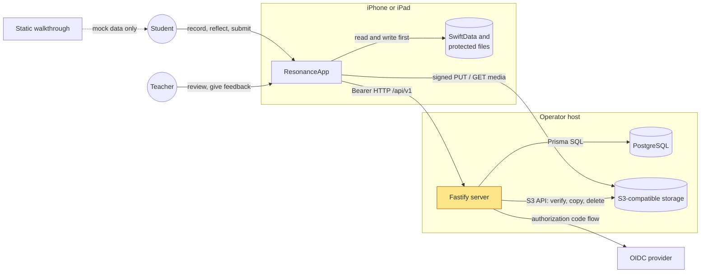

Students and teachers use the same app; course membership decides what each
one sees. The app writes everything to `local` first and talks to `api` only
when it syncs. Media bytes go straight between the app and `s3` using
short-lived signed URLs that `api` issues, so the server never streams uploads.
The [walkthrough](../demo/site/README.md) on GitHub Pages is a separate static
page with mock data; it has no connection to the app, server or stores.

Where in the code:
[server/src/app/index.ts](../server/src/app/index.ts) (process entry),
[ios/ResonanceApp/Sources/App/ResonanceApp.swift](../ios/ResonanceApp/Sources/App/ResonanceApp.swift) (app entry),
[infra/docker-compose.yml](../infra/docker-compose.yml) (local PostgreSQL and SeaweedFS).

## Server

### How it runs

`npm run dev` (development, `tsx watch`) or `npm start` (`node
dist/app/index.js`) starts one process. [`app/index.ts`](../server/src/app/index.ts)
connects to PostgreSQL within the dependency deadline, ensures the S3 bucket,
listens on `HOST:PORT` (default `127.0.0.1:4000`), and then runs the
maintenance jobs once at startup and every 60 seconds. `SIGTERM`/`SIGINT` close
HTTP, wait for in-flight maintenance, then disconnect PostgreSQL, each within a
5-second grace period. There is no separate worker process or queue: background
work runs on a timer inside the same process.

The maintenance pass in [`app/maintenance.ts`](../server/src/app/maintenance.ts)
runs these jobs in order, and never overlaps itself:

1. expire stale artifact uploads
2. prune retained failed artifacts
3. prune completed upload sessions
4. process queued S3 deletions (`StorageDeletionJob`, claimed with a lease)
5. expire sync command receipts
6. expire revoked refresh tokens

### What it is made of

Which layers handle a request, and which modules may call which?

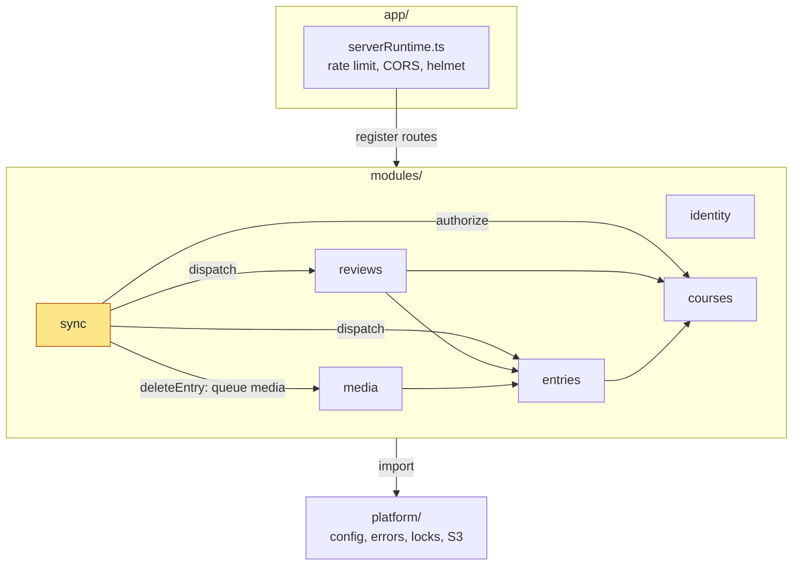

`server/src/server.ts` exports `buildServer(prisma, s3)`. `app/serverRuntime.ts`
registers the transport policy (rate limits, CORS, security headers, error
mapping), `/health` and `/ready`, and each module's routes. `platform/` holds
code no feature owns: configuration, the HTTP error, input, pagination and
authenticated-request contracts, deadlines, PostgreSQL advisory locks, and the
S3 adapter. Every arrow between modules points into the target's
`application/` directory; `identity` and `courses` use no other module, and
`platform` never imports modules or `app`. The graph is acyclic and checked by
`module-dependency-rules.test.ts` in the private server suite.

| Module | Owns |
| --- | --- |
| `identity` | Development login, OIDC, native PKCE code exchange, token sessions, issuer-scoped identity mapping, and the bearer-token `preHandler`. |
| `courses` | Course membership lookups, course-role authorization, and course lists. |
| `entries` | The practice-entry aggregate: entry commands and their rules (create, update, capture markers, submit), optimistic versions, entry locks, visibility and ownership, list and detail reads, and removal of the entry row. |
| `media` | Artifacts and their storage lifecycle: upload sessions, quotas, completion claims, container validation, download sessions, storage-deletion scheduling, and cleanup jobs. |
| `reviews` | Feedback: the create-feedback command and its rules, feedback reads, the review queue, and feedback removal. |
| `sync` | The v1 command gateway: envelope parsing, admission limits, durable receipts and replay, dispatch to the owning module, and mapping outcomes to sync results. |

Each module splits an `http/` adapter from an `application/` boundary. HTTP code
parses transport input and maps responses; application code owns rules,
authorization, and transactions. Commands throw `ApiError`s; a stale
`baseVersion` throws `EntryVersionConflictError`, which sync reports as a
`conflict` result carrying the current entry.

Sync dispatches each command to its owning module and composes the one use case
that spans modules. Deleting an entry runs, in one transaction: lock and
authorize the entry (only drafts can be deleted), queue its media for storage
deletion (media), delete feedback targeting it (reviews), then delete the entry
and keep a tombstone (entries). The rules govern imports; artifact, feedback,
and marker rows are children of the entry in the database, so entry and review
rules may read them inside the entry lock (for example, submission requires
uploaded artifacts) while their lifecycle stays with the owning module. Sync's
`entryResource` is the command-result projection of an entry, deliberately
without artifacts; entry reads use `entries/application/dto.ts`.

### One sync command, step by step

What does the server do with each command in a batch?

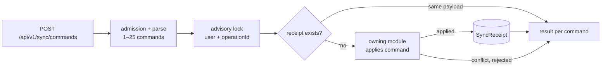

[`sync/http/routes.ts`](../server/src/modules/sync/http/routes.ts) runs the
commands of one request in order, each in its own transaction
([`executeSyncCommand`](../server/src/modules/sync/application/commands.ts)).
A retried command with the same operation ID and payload hash returns its stored
receipt; the same ID with a different payload is rejected. Only `applied`
outcomes write a receipt. Domain failures become `conflict` or `rejected`
results; unexpected and contention errors become `retryable`, so the client
keeps the item queued. A rate-limit error (429) fails the whole request.

## Client

The SwiftUI target is organized under `ios/ResonanceApp/Sources/`:

| Directory | Responsibility |
| --- | --- |
| `App` | Composition (`AppState`), navigation, and the demo and screenshot wiring. |
| `Core` | Domain models, persistence and the local-profile lifecycle, networking, security, media, calendar, export, and synchronization. No SwiftUI; UIKit only as platform adapters (background tasks, the web-auth presentation anchor, PDF rendering). |
| `Features` | Course, capture, entry, export, feedback, review, authentication, settings, and sync-status workflows, plus the environment they need from App (`FeatureEnvironment.swift`). |
| `SharedUI` | Reusable theme and presentation primitives. |

Core depends on nothing above it; SharedUI may use Core; Features may use Core
and SharedUI; only App sees everything. App injects services into features
through the SwiftUI environment (`ErrorReporter`, `apiClient`,
`capturePresentation`) rather than features reaching into App.
`scripts/check-ios-layers.mjs` derives each layer's declared types and rejects
any reference against this direction; it runs in `verify-repository.sh` and
`verify-ios.sh`. Screenshot capture code compiles only with the
`RESONANCE_SCREENSHOTS` condition and demo-data loading only in Debug or
capture builds, so Release builds contain neither.

### The outbox

How does a local change reach the server?

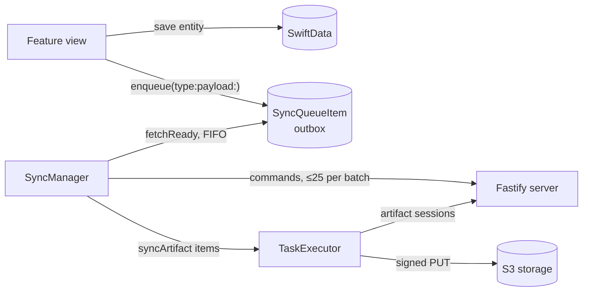

Features save the entity first, then call `SyncManager.enqueue`, which stores a
`SyncQueueItem` bound to the signed-in owner
([`QueueStore`](../ios/ResonanceApp/Sources/Core/Sync/QueueStore.swift)).
`processQueue()` runs when the app launches or returns to the foreground, from
the sidebar's Sync button, and from the sync-queue and settings screens. Each pass reads ready items oldest first, turns every
non-media item into a `SyncCommand`
([`TaskExecutor+Commands.swift`](../ios/ResonanceApp/Sources/Core/Sync/TaskExecutor+Commands.swift)),
and sends them in batches of 25. At most one command per entity goes into a
pass; later ones wait for the next pass. Items whose result is applied or
duplicate are deleted; others are marked failed or retried later. `syncArtifact`
items take the separate upload path shown in the [first journey](#record-and-upload-practice-audio).

## User journeys

These are the actions that reach the most of the architecture. Each sequence
is traced through the real call path.

### Record and upload practice audio

What happens after a student stops a recording?

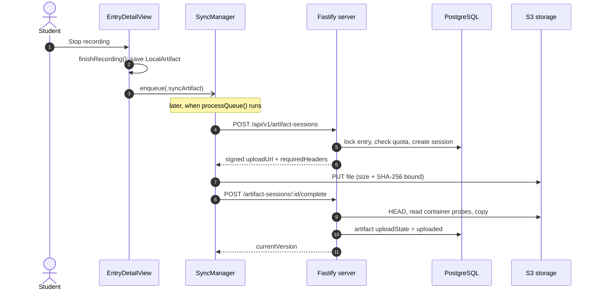

The recording is attached locally in step 2, so it survives being offline.
Step 5 sends the file size and padded-base64 SHA-256 checksum; the server binds
them into the signed upload (step 7) and checks them again on completion
(step 9) together with bounded ISO-BMFF probes for an M4A or MP4 brand with the
expected track. The artifact is only published after that check. A teaching
lesson uses the same path for its consented video.

Where in the code:
[EntryDetailView+Actions.swift](../ios/ResonanceApp/Sources/Features/Entries/EntryDetailView+Actions.swift) (`finishRecording`),
[TaskExecutor+Execution.swift](../ios/ResonanceApp/Sources/Core/Sync/TaskExecutor+Execution.swift) (`executeSyncArtifact`),
[media/http/routes.ts](../server/src/modules/media/http/routes.ts),
[sessionCreation.ts](../server/src/modules/media/application/sessionCreation.ts),
[sessionCompletion.ts](../server/src/modules/media/application/sessionCompletion.ts),
[mediaValidation.ts](../server/src/modules/media/application/mediaValidation.ts).

### Submit an entry

What happens when a student taps Submit?

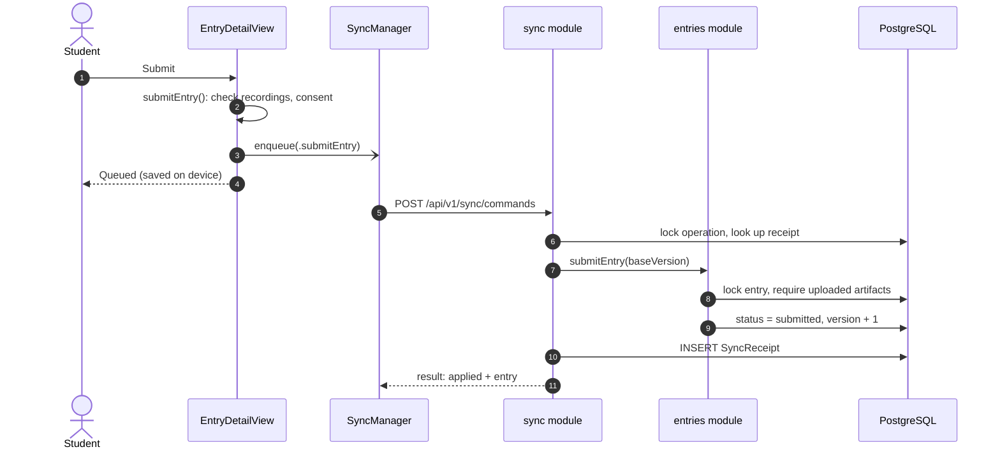

The student sees the queued state at step 4 whether or not the device is
online. In step 8 the entries module refuses the submission unless the entry is
a draft owned by the caller, its `baseVersion` is current, and every artifact is
uploaded (a teaching lesson also needs an uploaded video and recorded consent).
A stale version comes back as a `conflict` result with the server's copy, which
the client offers to reload or duplicate
([`SyncManager+ConflictRecovery.swift`](../ios/ResonanceApp/Sources/Core/Sync/SyncManager+ConflictRecovery.swift)).

Where in the code:
[EntryDetailView+Submission.swift](../ios/ResonanceApp/Sources/Features/Entries/EntryDetailView+Submission.swift),
[SyncManager+Processing.swift](../ios/ResonanceApp/Sources/Core/Sync/SyncManager+Processing.swift),
[sync/application/dispatch.ts](../server/src/modules/sync/application/dispatch.ts),
[entries/application/commands.ts](../server/src/modules/entries/application/commands.ts) (`submitEntry`).

### Review a submission and leave feedback

What does a teacher's review touch?

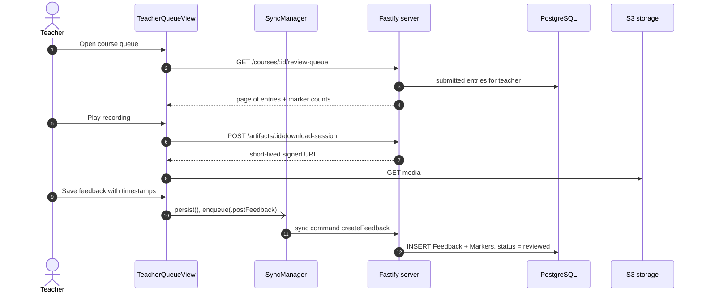

Reads (steps 2 and 6) go straight to the server and need a connection; the
feedback itself (step 10) is saved locally first and synced like any other
command. Step 3 checks the caller's course role, so teachers only see submitted
or reviewed entries in their own courses, never drafts. Step 12 runs in the
reviews module and moves the entry to `reviewed`.

Where in the code:
[TeacherQueueView.swift](../ios/ResonanceApp/Sources/Features/Review/TeacherQueueView.swift),
[SubmissionDetailView.swift](../ios/ResonanceApp/Sources/Features/Review/SubmissionDetailView.swift),
[FeedbackEditorView.swift](../ios/ResonanceApp/Sources/Features/Feedback/FeedbackEditorView.swift),
[FeedbackDraftQueueOperation.swift](../ios/ResonanceApp/Sources/Core/Sync/FeedbackDraftQueueOperation.swift),
[reviews/http/routes.ts](../server/src/modules/reviews/http/routes.ts),
[reviews/application/commands.ts](../server/src/modules/reviews/application/commands.ts),
[media/application/downloads.ts](../server/src/modules/media/application/downloads.ts).

### Sign in

How does the app get a bearer token?

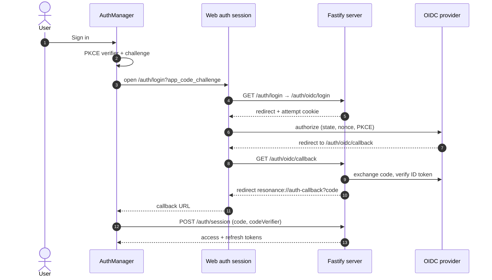

There are two separate PKCE pairs. The server keeps its own verifier, state,
nonce and browser binding for the provider (steps 5–9). The app keeps a second
verifier (step 2) and must present it with the one-time internal code at step
12; the `redirectUri` sent there must equal `APP_AUTH_REDIRECT_URI`. Step 9
maps `(issuer, subject)` to an internal user through `ExternalIdentity`. The app always
opens `/auth/login`; the server redirects it to `/auth/oidc/login`, or in `dev`
auth mode to the loopback-only `/dev/login` page instead of a real provider. Tokens are stored in the Keychain and refreshed through
`POST /auth/refresh`.

Where in the code:
[AuthManager+Authentication.swift](../ios/ResonanceApp/Sources/Core/Security/AuthManager+Authentication.swift),
[PKCE.swift](../ios/ResonanceApp/Sources/Core/Security/PKCE.swift),
[oidcRoutes.ts](../server/src/modules/identity/http/auth/oidcRoutes.ts),
[sessionRoutes.ts](../server/src/modules/identity/http/auth/sessionRoutes.ts),
[devLoginRoutes.ts](../server/src/modules/identity/http/auth/devLoginRoutes.ts),
[identity/application/oidc.ts](../server/src/modules/identity/application/oidc.ts).
See [OIDC integration](./SSO_BRIDGE.md) for provider setup.

## Data model

### Entry lifecycle

Which states does a practice entry go through on the server?

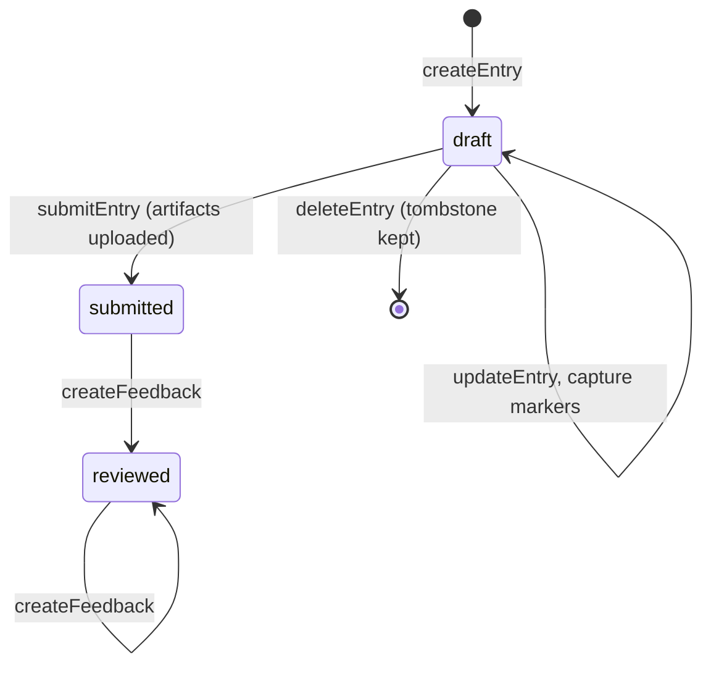

Only drafts can be edited, submitted or deleted. Every transition bumps the
entry `version`, which clients send back as `baseVersion`.

### What is stored

How are the PostgreSQL tables related?

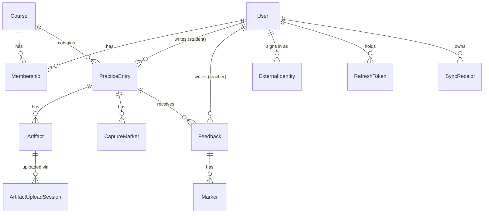

Deleting a user, course or entry cascades to its children. Tables not drawn
because they have no foreign keys: `DeletedEntryTombstone` (stops a retried
`createEntry` from reviving a deleted entry ID), `StorageDeletionJob` (S3 objects waiting to be removed),
and `AuthFlowToken` (hashed, single-use OIDC attempts and internal auth codes).
`Membership.roleInCourse` decides who is a student or teacher in a course.
Media bytes live in S3 under each artifact's `storageKey`, never in PostgreSQL.

On the device, SwiftData mirrors entries, artifacts, markers and feedback, plus
the `SyncQueueItem` outbox; recordings live as protected files under the app's
container ([`FileStore.swift`](../ios/ResonanceApp/Sources/Core/Persistence/FileStore.swift)).

Where in the code:
[server/prisma/schema.prisma](../server/prisma/schema.prisma),
`server/prisma/migrations/`,
[Persistence.swift](../ios/ResonanceApp/Sources/Core/Persistence/Persistence.swift).

## HTTP contracts

`/health` and `/ready` are unversioned operational endpoints, `/auth/*` is an
unversioned authentication boundary, and resource reads and media sessions are
versioned under `/api/v1`. The full route list is in [API](./API.md).

All externally initiated resource mutations go through one endpoint,
`POST /api/v1/sync/commands`. A request carries one to 25 typed commands. Each
command includes an operation ID, entity ID, kind, payload, and, where
required, an optimistic base version. Conflict results never silently
overwrite newer server state. There are no legacy unversioned
resource-mutation routes; extend the typed sync command contract instead of
adding resource-specific ones.

Artifact session creation, completion, and protected download-session creation
stay as versioned media operations because they issue or finalize scoped
storage capabilities. They are not a substitute for entry or feedback
mutations. Completion shares one storage deadline across metadata, cached
container probes, and the final copy, and its database claim outlives that
deadline.

## Identity and persistence

Prisma owns PostgreSQL access. `ExternalIdentity` maps an `(issuer, subject)`
pair to a stable internal user, so an OIDC subject is never assumed globally
unique. OIDC and internal app codes are short-lived and single-use, and the
server stores hashes of bearer values. Media storage is reached through the
platform S3 adapter; application modules enforce ownership, course membership,
and consent before issuing capabilities or returning protected media.

For an installed alpha, local persisted data is destructively reset only from
the known predecessor generation. Unknown or incomplete state fails closed and
requires user-directed recovery. This is a client persistence boundary, not an
operator migration procedure.

## Build and release

What runs on a pull request, and what gets published?

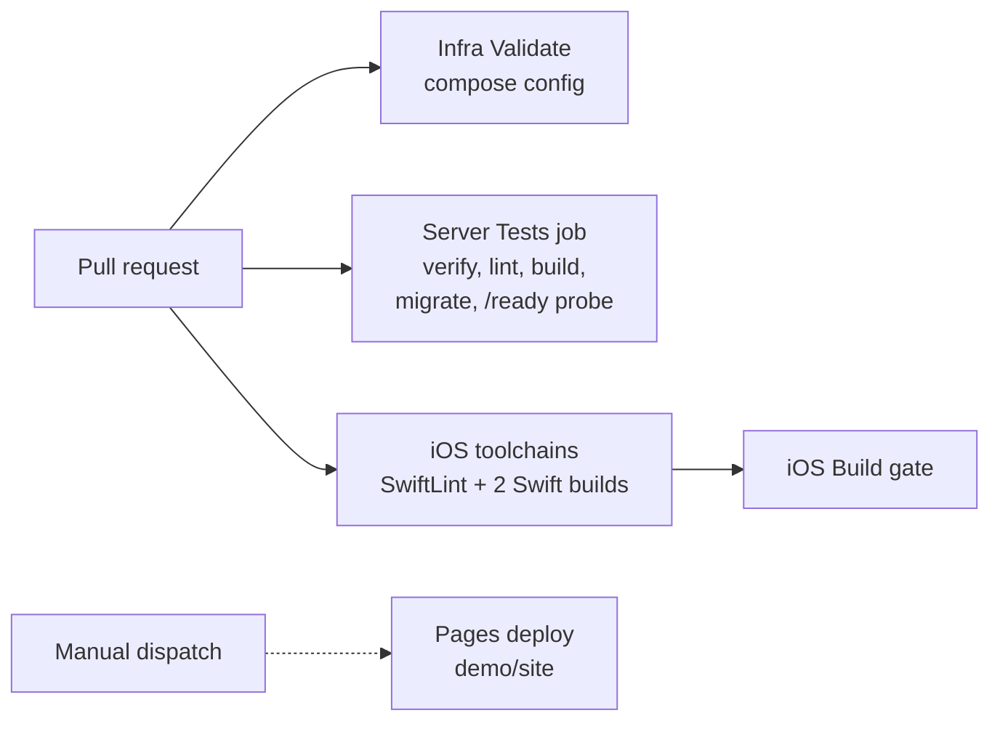

[`ci.yml`](../.github/workflows/ci.yml) runs on pull requests and manual
dispatch. The server job runs `verify-repository.sh`, a production dependency
audit, lint, dead-code and duplication checks, formatting, ShellCheck,
actionlint, Prisma generate and migrate against a disposable PostgreSQL
service, typecheck, build, and finally starts `dist/app/index.js` and waits for
`/ready`. The iOS job builds with both the Xcode-bundled Swift and the exact
Swift 6.3.3 toolchain on macOS. The DB-backed server test suite under
`server/tests/` is private (gitignored) and is not part of hosted CI.
[`pages.yml`](../.github/workflows/pages.yml) publishes `demo/site/` only when
dispatched manually. `codeql.yml` and `security-audit.yml` also run weekly.

- The server is a private Node.js package. TypeScript compiles to
  `server/dist/`, and `dist/app/index.js` starts the one server process.
- The iOS app builds from the tracked Xcode project and shared scheme, the only
  iOS build definition. Its folder-synchronized groups include every file under
  `Sources/`.
- `contracts/v1-api-contract.json` is the hand-maintained cross-component
  contract. A generated region in the Swift networking contract test projects
  its route and payload vocabulary.
- `infra/docker-compose.yml` supplies disposable loopback development
  dependencies: PostgreSQL and SeaweedFS as the S3-compatible store. The
  repository has no production server image, infrastructure provisioning,
  application signing, TestFlight, backup, or monitoring workflow.

Production TLS, secrets, CORS, PostgreSQL, S3, identity-provider operation,
backup, retention, monitoring, and distribution are operator-owned boundaries,
not features implemented here. [Releasing](./RELEASING.md) covers versioning.

## Code map

Ordered as a newcomer would read it.

| Path | Responsibility |
| --- | --- |
| [contracts/v1-api-contract.json](../contracts/v1-api-contract.json) | Shared route and command vocabulary for both sides |
| [server/src/app/index.ts](../server/src/app/index.ts) | Process start, maintenance timer, graceful shutdown |
| [server/src/app/serverRuntime.ts](../server/src/app/serverRuntime.ts) | Fastify transport policy, health and readiness, route registration |
| `server/src/modules/sync/` | Command gateway: admission, receipts, dispatch |
| `server/src/modules/entries/` | Practice-entry rules, versions, locks, reads |
| `server/src/modules/media/` | Upload and download sessions, validation, cleanup |
| `server/src/modules/reviews/` | Feedback command, review queue, feedback reads |
| `server/src/modules/identity/` | OIDC, dev login, token sessions, bearer auth |
| `server/src/modules/courses/` | Course lists and course-role authorization |
| `server/src/platform/` | Config, errors, input parsing, locks, S3 adapter |
| [server/prisma/schema.prisma](../server/prisma/schema.prisma) | Database schema; migrations next to it |
| `ios/ResonanceApp/Sources/App/` | `AppState` composition, navigation, sync triggers |
| `ios/ResonanceApp/Sources/Features/` | Screens: capture, entries, review, feedback, settings |
| `ios/ResonanceApp/Sources/Core/Sync/` | Outbox, `SyncManager`, `TaskExecutor` |
| `ios/ResonanceApp/Sources/Core/Networking/` | `APIClient` and wire models |
| `ios/ResonanceApp/Sources/Core/Security/` | `AuthManager`, PKCE, Keychain |
| `ios/ResonanceApp/Sources/Core/Persistence/` | SwiftData container, protected file storage |
| `scripts/` | Repository, contract, layer and iOS verification |
| `demo/site/` | Static walkthrough (presentation only) |

## Where new code belongs

- Add an endpoint in the owning module's `http/` directory and add it to the
  route-ownership list in `module-dependency-rules.test.ts`.
- Put business rules, DTOs, authorization, and transactions in the owning
  module's `application/` directory. A new resource mutation is a new sync
  command kind whose handler lives in the owning module; sync only dispatches
  it and maps its outcome.
- Put Fastify-wide behavior, configuration, errors, deadlines, locks, and
  storage adapters in `platform/`. Keep advisory-lock namespaces in
  `platform/database/advisoryLocks.ts`; their values are persisted lock keys.
- Put iOS workflow UI in `Features`, reusable domain rules, transport,
  persistence, and sync in `Core`, generic visuals in `SharedUI`, and
  composition, navigation, demo, and screenshot wiring in `App`.
- Update [API](./API.md), tests, and Swift transport/outbox models when a public
  contract changes.

## Extension rules and non-goals

- Extend the existing owning module rather than adding a second composition root
  or another deployable service.
- Add resource mutation behavior as a typed sync command. Media capability
  creation and completion stay separate because the client transfers bytes
  directly to storage.
- Treat the static walkthrough as presentation, not as product evidence or a
  test client.
- A SAML-only institution needs an external SAML-to-OIDC bridge; this repository
  implements OIDC, not SAML.

Component setup and verification live in the [server README](../server/README.md),
[iOS README](../ios/ResonanceApp/README.md), and
[development guide](./DEVELOPMENT.md).
